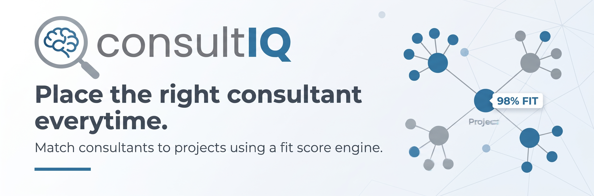
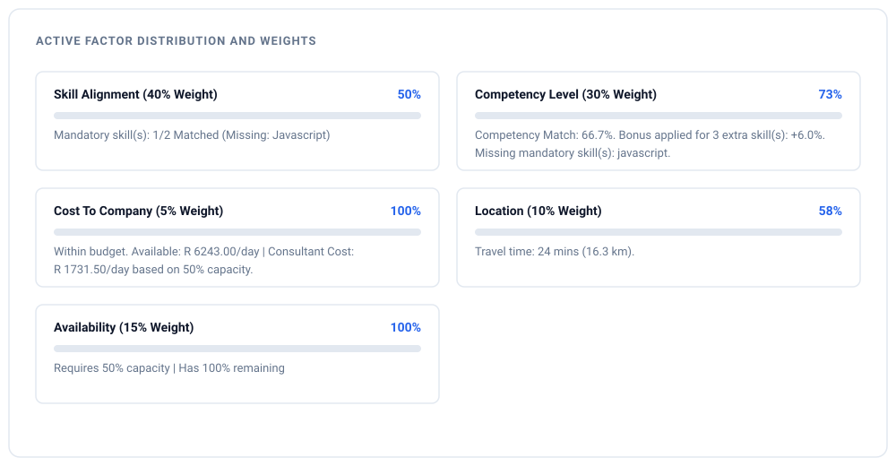
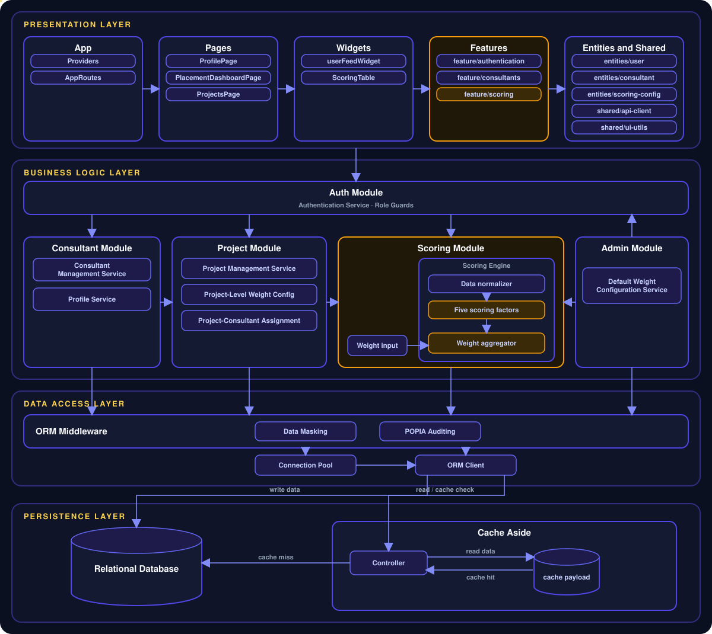
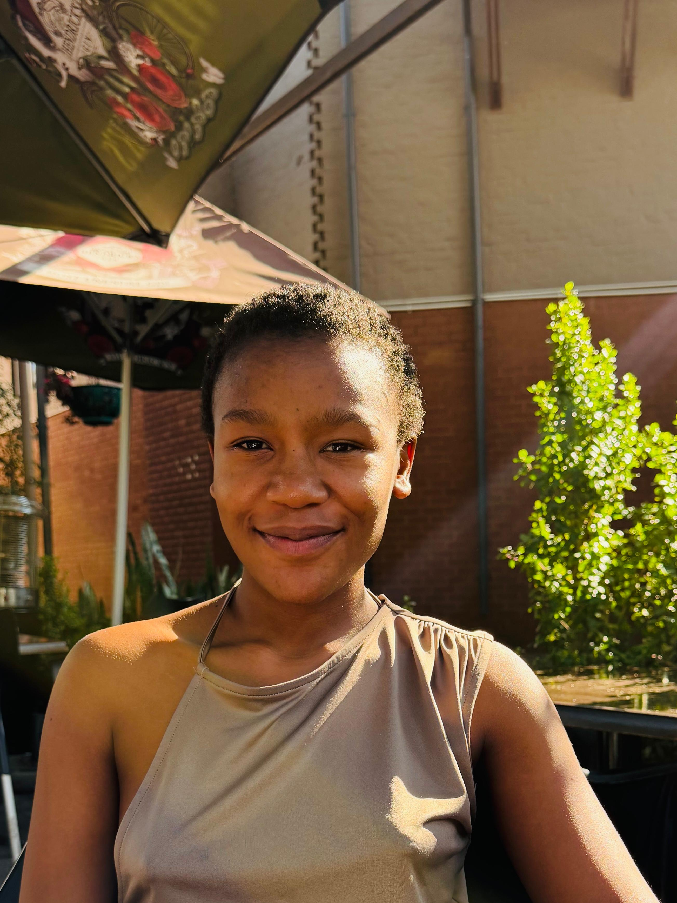

<div align="center">



<br/>


<p>
  
</p>

<p>
  <a href="https://consult-iq-red.vercel.app"></a>
<a href="https://drive.google.com/file/d/1apocEvBB11FWkwiOTPVL6v7TcI-tsJf_/view?usp=sharing"></a>


</div>

---

<div align="center">

## Project Health

[](https://github.com/COS301-SE-2026/ConsultIQ/actions)
[](https://codecov.io/gh/COS301-SE-2026/ConsultIQ)
[](https://consult-iq-red.vercel.app)
[](https://github.com/COS301-SE-2026/ConsultIQ/issues)
[](https://github.com/COS301-SE-2026/ConsultIQ/pulls)
[](https://github.com/COS301-SE-2026/ConsultIQ/graphs/contributors)

</div>

---

## What is ConsultIQ?

ConsultIQ is an intelligent matching and resource-management platform built by team **TROOS**. It helps consultancy industries manage consultant and project information, identify suitable candidates for the job, and plan consultant capacity.

The matching engine evaluates configurable factors such as skills, competency, cost, location, and availability. It produces a **ranked shortlist** with score explanations so managers can understand exactly how a match was calculated. Matching results are decision support; managers remain responsible for reviewing and approving placements.

### Key Capabilities

* **Consultant and project management** — maintain consultant profiles, skills, competency levels, and project requirements.
* **Explainable matching** — rank candidates against project requirements and show contributing score factors.
* **Configurable scoring** — adjust scoring weights and project-level configuration.
* **CV parsing** — upload CVs and review extracted information before using it in a consultant profile.
* **Feasibility analysis** — compare project/resource feasibility scenarios.
* **Scheduling and planning** — organize work in calendar blocks and task slots, with validation and scheduling assistance.
* **Team skill-demand reporting** — review skill supply, training gaps, and uncovered project requirements.

---

## How It Works

1. A manager defines a project and its requirements.
2. ConsultIQ evaluates eligible consultants using the configured scoring factors and any applicable exclusions.
3. Candidates are ranked and presented with an explanation of their scores.
4. The manager reviews the shortlist and makes the placement decision.

*The exact scoring configuration and calculations are described in the [scoring engine specification](<Documents/Demo 4/ConsultIQ_Scoring_Engine.pdf>).*

## Know Why a Candidate Ranked First



## System Architecture



---

## Tech Stack

<div align="center">

<sub><b>WEB APPLICATION</b></sub><br/>


<sub><b>API</b></sub><br/>


<sub><b>PERSISTENCE, CACHING AND JOBS</b></sub><br/>


<sub><b>CV AND FILE PROCESSING</b></sub><br/>


<sub><b>EMAIL AND AI</b></sub><br/>


<!-- 
 -->

<sub><b>HOSTING AND DELIVERY</b></sub><br/>


<sub><b>TESTING</b></sub><br/>


</div>

<br/>

| Area | Technologies |
| ----- | ----- |
| **Web application** | React, Vite, TypeScript, Tailwind CSS |
| **API** | NestJS (Node.js), Prisma ORM |
| **Persistence** | PostgreSQL, Redis |
| **Caching and jobs** | Redis, BullMQ |
| **CV and file processing** | PDF/document parsing, Tesseract.js, AWS S3 |
| **Email and AI integrations** | Resend, Anthropic SDK, LangChain, Vercel AI SDK |
| **Hosting and delivery** | Vercel, AWS (backend hosting), Docker, GHCR, GitHub Actions |
| **Testing** | Jest, Supertest, React Testing Library, Playwright, k6 |
---

## Live System & Deployment

| Environment | URL | 
| ----- | ----- | 
| Production (frontend) | https://consult-iq-red.vercel.app | 

Backend and infrastructure deployment configuration is maintained in the root Docker Compose files and GitHub Actions workflows. Deployment requires environment-specific secrets and infrastructure. For current deployment status and workflow history, see [GitHub Actions](https://github.com/COS301-SE-2026/ConsultIQ/actions).

---

## Documentation

<details open>
<summary><strong>Demo 4</strong></summary>

<br>

| Resource | Link | 
| ----- | ----- | 
| System Requirements Specification | [SRS V3](https://github.com/COS301-SE-2026/ConsultIQ/blob/feature/docs/dem4/Documents/Demo%204/SRS_V3.pdf) | 
| System Architecture Specification | [SAS V2](https://github.com/COS301-SE-2026/ConsultIQ/blob/feature/docs/dem4/Documents/Demo%204/SAS_V2.pdf) | 
| User Manual | [User Manual V2](https://github.com/COS301-SE-2026/ConsultIQ/blob/feature/docs/dem4/Documents/Demo%204/User%20manual_V2.pdf) | 
| Scoring Engine | [ConsultIQ Scoring Engine](<Documents/Demo 4/ConsultIQ_Scoring_Engine.pdf>) |
| Feasibility analysis | [Feasibility Advisor technical design](<Documents/Demo 4/ConsultIQ_Feasibility_Advisor_Technical_Design.pdf>) |
| Growth Compass | [Growth Compass technical design](<Documents/Demo 4/ConsultIQ_Growth_Compass_Technical_Design.pdf>) |
| CV parsing | [Technical implementation and design rationale](<Documents/Demo 4/CV Parsing_ Technical Implementation and Design Rationale.pdf>) |
| CV data privacy | [CV Parsing POPIA documentation](<Documents/Demo 4/CV-PARSING POPIA DOCUMENTATION (1).pdf>) |
| Service contract | [Service Contract](<Documents/Demo 4/service_contract.pdf>) |

</details>

<details>
<summary><strong>Demo 3</strong></summary>

<br>

| Resource | Link | 
| ----- | ----- | 
| System Requirements Specification | [SRS V3](https://github.com/COS301-SE-2026/ConsultIQ/blob/main/Documents/Demo%203/SRS_V3.pdf) | 
| System Architecture Specification | [SAS V2](https://github.com/COS301-SE-2026/ConsultIQ/blob/main/Documents/Demo%203/SAS_V2.pdf) | 
| User Manual | [User Manual V2](https://github.com/COS301-SE-2026/ConsultIQ/blob/main/Documents/Demo%203/User%20manual_V2.pdf) | 
</details>

<details>
<summary><strong>Demo 2</strong></summary>

<br>

| Resource | Link | 
| ----- | ----- | 
| System Requirements Specification | [SRS V2](https://github.com/COS301-SE-2026/ConsultIQ/blob/feature/documetation/Documents/Demo%202/SRS%20V2.pdf) | 
| System Architecture Specification | [SAS](https://github.com/COS301-SE-2026/ConsultIQ/blob/feature/documetation/Documents/Demo%202/SAS%20\(1\).pdf) | 
| Coding Standards | [Coding Standards V2](https://github.com/COS301-SE-2026/ConsultIQ/blob/feature/documetation/Documents/Demo%202/Coding%20Standards_V2.pdf) | 
| Testing Policy | [Testing Policy](https://github.com/COS301-SE-2026/ConsultIQ/blob/feature/documetation/Documents/Demo%202/testing_policy%20\(1\).pdf) | 
| User Manual | [User Manual](https://github.com/COS301-SE-2026/ConsultIQ/blob/feature/documetation/Documents/Demo%202/User%20manual.pdf) | 
| Brand Style Guide | [Brand Style Guide V2](https://github.com/COS301-SE-2026/ConsultIQ/blob/feature/documetation/Documents/Demo%202/Brand%20Style%20Guide%20V2.pdf) | 
| Figma UI Panels | [High-fidelity wireframes](https://www.figma.com/design/S4Ydfuk6L0YkWhdjdRGxf9/High_fidelity_wireframes?node-id=0-1&p=f&t=m8cf3g1IC16ToRs4-0) | 
</details>

<details>
<summary><strong>Demo 1</strong></summary>

<br>

| Resource | Link | 
| ----- | ----- | 
| Functional Requirements | [SRS](https://github.com/COS301-SE-2026/ConsultIQ/blob/main/Documents/SRS.pdf) | 
| Project Board | [TROOS Project Board](https://github.com/orgs/COS301-SE-2026/projects/66) | 
</details>

---

## Project Structure

This repository is a **monorepo**.

```text
ConsultIQ/
├── backend/                 # NestJS API, Prisma schema, and backend tests
├── frontend/                # React/Vite web application
├── tests/
│   ├── e2e/                 # Playwright end-to-end tests
│   ├── ui/                  # Playwright UI tests
│   └── load/                # k6 load-test scenarios
├── Documents/               # Capstone specifications, manuals, and assets
├── docker-compose.yml       # Local development services
├── docker-compose.staging.yml
├── docker-compose.prod.yml
└── .github/workflows/       # CI, deployment, and test workflows
```

---

## Getting Started

### Prerequisites

* Git
* Docker and Docker Compose for the containerized setup
* Node.js and npm for local development outside Docker; use the repository's `.nvmrc` when using nvm

### Run the local stack with Docker Compose

```bash
git clone https://github.com/COS301-SE-2026/ConsultIQ.git
cd ConsultIQ

# Create local environment files from the checked-in templates.
cp backend/.env.example backend/.env
cp frontend/.env.example frontend/.env

# Review the values in both files before starting the services.
docker compose up --build
```
The development compose configuration starts PostgreSQL, Redis, the API, and the web application. When startup completes, open:

- Frontend: <http://localhost:5173>
- Backend: <http://localhost:3000>

The compose file uses `VITE_API_URL` from the shell or a root-level `.env` file when building the frontend; if it is not set, it defaults to `http://localhost:3000`. The frontend `.env.example` is configured for the hosted API, so change `VITE_API_URL` to the local API URL when running the frontend outside Docker.

To stop the local stack, run:
```bash
docker compose down
```

### Environment configuration

Use `backend/.env.example` and `frontend/.env.example` as templates. Replace placeholders with values appropriate for your local environment and integrations. Depending on the features you run, the backend may need database, Redis, authentication, email, AI, and object-storage configuration.


### Run services without Docker

If you run the applications directly, start PostgreSQL and Redis first, configure the backend environment, and install each application's dependencies in its own directory:

```bash
cd backend
npm ci
npm run prisma:generate
npm run prisma:migrate:deploy
npm run start:dev
```

In a second terminal:

```bash
cd frontend
npm ci
npm run dev
```
Set `VITE_API_URL` in the frontend environment to the backend URL. Database migrations must be applied to the configured development database before using the API.

---

## Branching Strategy

We follow a structured Git Flow to keep quality high and `main` always deployable.

| Branch | Purpose | 
| ----- | ----- | 
| `main` | Production-ready and stable. Merges need PR approval and a passing CI build. | 
| `develop` | Primary integration branch for the next release. | 
| `feature/*` | New features, branched from `develop` (for example `feature/fit-scoring-engine`). | 
| `bugfix/*` and `hotfix/*` | Bug fixes (for example `bugfix/auth-token-refresh`). | 

---

## Testing and Quality Checks

Install dependencies in the relevant project directory before running its checks.

| Check | Command | Notes |
| :--- | :--- | :--- |
| **Backend unit tests** | `cd backend && npm test -- --runInBand` | Jest |
| **Backend integration tests** | `cd backend && npm run test:int` | Requires a dedicated `.env.test` and test database |
| **Backend lint** | `cd backend && npm run lint` | The script applies ESLint fixes |
| **Backend build** | `cd backend && npm run build` | NestJS production build |
| **Frontend tests** | `cd frontend && npm test` | Jest and React Testing Library |
| **Frontend lint** | `cd frontend && npm run lint` | ESLint |
| **Frontend build** | `cd frontend && npm run build` | Vite production build |
| **Playwright UI tests** | `npm run test:ui` | Install root & frontend deps, then Playwright browsers |
| **Playwright E2E tests** | `npm run test:e2e` | Install root, backend & frontend deps; requires test services and `backend/.env.test` |

Install the Playwright browsers from the repository root with:

```bash
npm ci
npm ci --prefix frontend
npm run playwright:install
```


## Rollback Strategy

Deployments use **image tag pinning**. Every build produces two Docker image tags:

* `latest` or `staging`: the currently deployed version
* `{commit-sha}`: a permanent reference to that exact build

**To roll back a failed production deployment:**

1. Find the last working commit SHA in the [GitHub Actions history](https://github.com/COS301-SE-2026/ConsultIQ/actions).
2. SSH into the production host:
   ```bash
   ssh -i <your-key>.pem ubuntu@<EC2_HOST>
   ```
3. Pin the backend image to that SHA in the production compose file:
   ```bash
   nano /home/ubuntu/ConsultIQ/docker-compose.prod.yml
   ```
   ```yaml
   # before
   image: ghcr.io/cos301-se-2026/consultiq-backend:latest
   # after
   image: ghcr.io/cos301-se-2026/consultiq-backend:{previous-sha}
   ```
4. Redeploy:
   ```bash
   docker-compose -f docker-compose.prod.yml up -d
   ```

To roll back **staging**, repeat the same steps with `docker-compose.staging.yml`.

---

## Meet the Team

<div align="center">
  
</div>

<table>
  <tr>
    <td align="center" width="33%" valign="top">
      <br/>
      <b>Ofentse Modika</b><br/>
      <sub>Team Lead · Backend · DevOps</sub><br/><br/>
      <sub>Final-year BSc Computer Science student with a strong interest in cybersecurity, financial technology and system architecture.</sub><br/><br/>
      <a href="https://github.com/Ofentse360"></a>
      <a href="https://www.linkedin.com/in/ofentse-modika-b09126248"></a>
    </td>
    <td align="center" width="33%" valign="top">
      <br/>
      <b>Siyabonga Sibiya</b><br/>
      <sub>Business Analyst · Database · Backend</sub><br/><br/>
      <sub>Computer Science student who enjoys using technology to build smart, efficient solutions, with interests in fintech and IoT.</sub><br/><br/>
      <a href="https://github.com/SiyaSibiya"></a>
      <a href="http://www.linkedin.com/in/siyabonga-sibiya-086543237"></a>
    </td>
    <td align="center" width="33%" valign="top">
      <br/>
      <b>Onthatile Molebaloa</b><br/>
      <sub>Database · Frontend</sub><br/><br/>
      <sub>Third-year BSc Computer Science student building interfaces with React, HTML, CSS and JavaScript, and back ends with Node.js, Supabase, MySQL, MongoDB, Python, Java and C++.</sub><br/><br/>
      <a href="https://github.com/Onthatile-22659812"></a>
      <a href="https://www.linkedin.com/in/onthatile-molebaloa-93a4642a8/"></a>
    </td>
  </tr>
  <tr>
    <td align="center" width="33%" valign="top">
      <br/>
      <b>Tshireletso Sebake</b><br/>
      <sub>Frontend · DevOps</sub><br/><br/>
      <sub>Final-year Computer Science student working across the stack with C++, Java, JavaScript, React, Next.js, NestJS, Go and PostgreSQL.</sub><br/><br/>
      <a href="https://github.com/Ramatsobane29"></a>
      <a href="https://www.linkedin.com/in/tshireletso-sebake-9b3397253/"></a>
    </td>
    <td align="center" width="33%" valign="top">
      <br/>
      <b>Retshepile Nkwana</b><br/>
      <sub>Backend · DevOps · Data Analyst</sub><br/><br/>
      <sub>Full-stack developer focused on backend work, strongest in Java and also experienced in C#, .NET and Node.js, with React and Next.js on the frontend.</sub><br/><br/>
      <a href="https://github.com/RNkwana"></a>
      <a href="https://www.linkedin.com/in/retshepile-nkwana-817297292/"></a>
    </td>
  </tr>
</table>

### Contact Details

| Detail | Information |
| :--- | :--- |
| **Email** | [teamtroos@gmail.com](mailto:teamtroos@gmail.com) |

---

<div align="center">
  <sub>Built by team TROOS for COS 301 · In Collaboration with BBD</sub>
</div>
